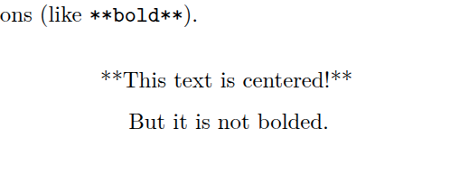
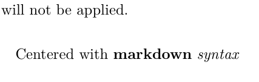

**Format Supported**: PDF (LaTeX)

## Solution

:::{.callout-tip}
### Centering Text in PDF Output
```md
:::{.center data-latex=""}
Centered and **bolded** text with _italics_
:::
```
:::

If you want the centered text to [match the font style of the headings](@sec-center-header-text).

## Video

<video controls src="https://videos.tmas.app/r-tips/r-tips-07-03-text-centering.mp4">

</video>

## Discussion

Quarto has no built-in way to center plain text in PDF output. You can, however, center text using a couple of approaches.

### Raw LaTeX

One option is to use LaTeX environments to do that:

```tex
\begin{center}
This text is centered!
\end{center}
```

The problem is that when inside a LaTeX environment like the above, you can no longer use Quarto's built-in formatting options such as `**bold**`. See @fig-center-no-bold.

:::::{#fig-center-no-bold}
::::{.columns align="center"}
:::{.column width="50%"}

```tex
\begin{center}
**This text is centered!**

But it is not bolded.
\end{center}
```
:::
:::{.column width="50%"}
{.bordered width="80%"}
:::
::::
Centered, but markdown formatting is not applied inside a LaTeX environment.
:::::

### Fenced Div

A better option is to use a _fenced div_. These begin with `:::` and end with `:::`. When you nest one div inside another, the outer div needs more colons than the inner one: `::::`, `:::::`, and so on. The most important part is to ensure that you include the `data-latex=""` attribute; see @fig-center-result. You will not receive an error if you omit it, but the centering will not be applied: `data-latex=""` tells Quarto to emit a plain LaTeX `center` environment for the div, and without it Quarto's default div output leaves the text left-aligned.

:::::{#fig-center-result}
::::{.columns align="center"}
:::{.column}
```md
:::{.center data-latex=""}
Centered with **markdown** _syntax_
:::
```
:::
:::{.column}
{.bordered width="90%"}
:::
::::
Centered with formatting applied properly.
:::::

#### Centered Header Text {#sec-center-header-text}

:::{.callout-tip}
### Match the Header Font Style
```md
:::{.center data-latex=""}
\usekomafont{disposition}\usekomafont{subsection}
Centered and same font-style as Quarto headers
:::
```
:::

Changing the font size is a bit tricky, but it can be done with some LaTeX syntax inside the fenced div.

- `\Large` $\approx$ `#`
- `\large` $\approx$ `##`
- `\normalsize` $\approx$ `###`

The problem with using `\Large` and related followed by using `**...**` for bold is that the font style is not the same as "regular" Quarto headers.

For example, see @fig-center-font-difference where we can see the difference in font style between the first and second lines. In particular, focus on the italicized word, "syntax".

```md
:::{.center data-latex=""}
\large
**Centered with markdown _syntax_**
:::

## Centered with markdown _syntax_

:::{.center data-latex=""}
\usekomafont{disposition}\usekomafont{subsection}
Centered with markdown _syntax_
:::
```

{#fig-center-font-difference .bordered width="90%"}

In order to obtain the same font-style as the headings, we have to use the following line above the header text:

```md
\usekomafont{disposition}\usekomafont{subsection}
```

(The `\usekomafont{...}` commands come from KOMA-Script. They work here because Quarto's default PDF document class is `scrartcl`, so they may not if you have set a custom documentclass.)

## Acknowledgements

- Claude Opus 5.5 helped with formatting the HTML page and provided information on Quarto syntax.
- Qwen3.8-27B managed the project repository and edited the video to trim the beginning and end, adjust the volume, and speed up sections.
- GLM-5.3-Flash provided information on Quarto syntax and checked for clarity once the document was completed. Several suggestions were implemented to improve the document flow.